## Hi there 👋

I'm Matt Preston. I also commit under
[@MattPreston-PAS](https://github.com/MattPreston-PAS) and
[@MattPreston-ZT](https://github.com/MattPreston-ZT).

## Combined GitHub contributions

Merged contribution graph across my GitHub accounts —
[@MattPreston-PAS](https://github.com/MattPreston-PAS),
[@MattPreston-ZT](https://github.com/MattPreston-ZT), and
[@moose0030](https://github.com/moose0030).


### By year

<!-- contributions:start -->

<b>2026</b> — 374 contributions


<b>2025</b> — 1,091 contributions

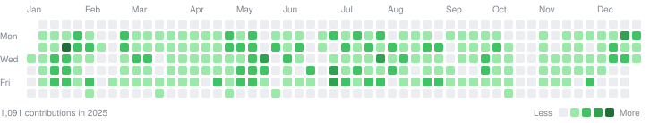

<b>2024</b> — 1,639 contributions

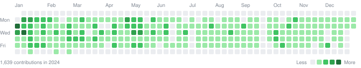

<b>2023</b> — 2,056 contributions

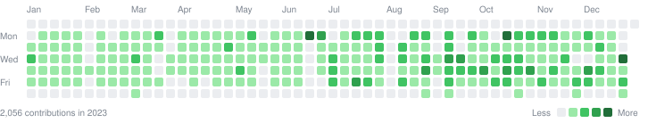

<b>2022</b> — 1,382 contributions

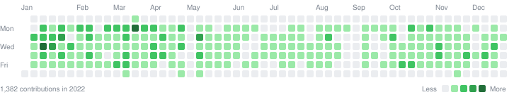

<b>2021</b> — 1,104 contributions

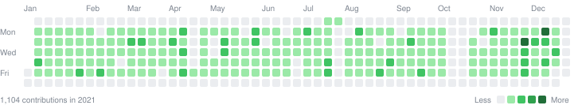

<b>2020</b> — 724 contributions

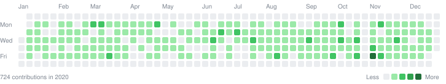

<b>2019</b> — 194 contributions


<b>2018</b> — 0 contributions


<b>2017</b> — 0 contributions


<b>2016</b> — 20 contributions


<b>2015</b> — 3 contributions


<!-- contributions:end -->

Public contributions only, refreshed daily by
[this workflow](.github/workflows/contributions.yml).
